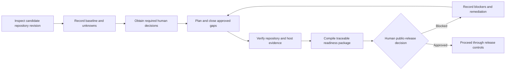

# Business Requirements Document

## Objectives

1. Establish an evidence-backed open-source readiness baseline for the candidate repository revision.
2. Identify and close approved gaps across legal, community, governance, security, user documentation, maintenance, engineering validation, and release readiness.
3. Preserve human authority over licensing, legal interpretation, governance, maintenance commitments, security-risk acceptance, and public release.
4. Provide a traceable decision package that lets the accountable human determine whether the repository is ready for public release.

## Stakeholders
| Role | Name | Interest | RACI |
|---|---|---|---|
| Product owner | `@mjtpena` | Scope, requirements, governance, and readiness decision package | Accountable for G1 approval; consulted on implementation |
| Contributors | TBD(@mjtpena, identify representative contributors for requirements review) | Contribution, review, conduct, and recognition expectations | Consulted |
| Users and adopters | TBD(@mjtpena, identify representative adopters for documentation review) | Installation, usage, compatibility, maintenance, and release information | Consulted |
| Security reporters | TBD(@mjtpena, identify a reviewer of the vulnerability-reporting journey) | A confidential reporting route and published response expectations | Consulted |
| Release manager | `@mjtpena` | Candidate revision, publication channel, release evidence, and rollback planning | Accountable for the human release decision |
| Technical lead / repository administrator | `@mjtpena` | Validation evidence, repository settings, compatibility, and merge controls | Responsible for technical verification |
| Security owner | `@mjtpena` | Security review, reporting controls, and risk decisions | Accountable for security-risk acceptance |
| Legal or licensing reviewer | TBD(@mjtpena, name the human legal or licensing reviewer) | Licence, copyright provenance, notices, and third-party obligations | Consulted; human legal interpretations required |
| Australian Government domain owner | TBD(@mjtpena, name the domain owner or declare the domain layer non-applicable) | Applicability and versions of domain frameworks | Consulted |

## Current & future business process

The current repository has FEOS governance and validation assets, but the Discovery inventory found no repository-level licence, contribution guide, code of conduct, security policy, support policy, governance document, issue templates, changelog, or packaging metadata. Host-side settings and the present result of validation commands remain unverified. The future process separates repository evidence from host evidence, requires unresolved human decisions to remain visible, and prohibits a readiness recommendation while a critical blocker remains open.

## Business requirements
| ID | Requirement | Rationale | Priority (MoSCoW) | Success metric |
|---|---|---|---|---|
| BR-001 | The initiative shall assess the candidate repository revision against a human-approved open-source readiness baseline and record every assessed criterion as met, unmet, not applicable with rationale, or blocked by a named decision. | A consistent baseline prevents omissions and distinguishes evidence from assumptions. | Must | Baseline: no approved baseline exists. Target: 100% of approved criteria have one recorded outcome. |
| BR-002 | The initiative shall retain human decisions and review evidence for licensing, copyright provenance, third-party obligations, and notices before recommending public release. | Public release without permissions and provenance review creates legal and adoption risk. | Must | Baseline: licence and named reviewer are absent. Target: 100% of required legal and licensing decisions have human evidence, or release remains blocked. |
| BR-003 | The initiative shall publish approved contribution, governance, conduct, and community-participation expectations for the candidate release. | Contributors need predictable participation, review, decision, and conduct processes. | Must | Baseline: the Discovery inventory found none of the required community documents. Target: 100% of the human-approved community baseline is present and reviewed. |
| BR-004 | The initiative shall publish a human-approved confidential vulnerability-reporting route and security-response expectations and shall verify the security controls selected for the candidate release. | Reporters need a safe route, while maintainers need evidence that local and host controls match published claims. | Must | Baseline: security policy and verified host controls are absent. Target: 100% of approved security-readiness criteria have evidence and 0 unresolved critical release blockers. |
| BR-005 | The initiative shall publish accurate installation, usage, compatibility, maintenance, and user-assistance boundaries for the candidate release. | Adopters must be able to determine whether and how they can use the project without relying on unstated commitments. | Must | Baseline: README exists; compatibility and maintenance commitments are undecided. Target: 100% of approved user-information criteria are evidenced. |
| BR-006 | The initiative shall define the candidate release identity, included artefacts, publication channel, versioning rules, release communication, and rollback boundary through retained human decisions. | Release execution is ambiguous while the channel, artefacts, and version are unknown and the workflow contains placeholders. | Must | Baseline: no channel, artefact set, version, or policy is selected. Target: 100% of approved release criteria have retained decisions and evidence. |
| BR-007 | The initiative shall produce current evidence for every configured hard validation check on the candidate revision without weakening FEOS controls, tests, schemas, CI, gates, or linters. | Historical evidence cannot establish the quality of the candidate revision. | Must | Baseline: current command results are unrecorded. Target: all configured hard checks pass on the candidate revision. |
| BR-008 | The initiative shall provide a traceable readiness decision package that identifies evidence, unresolved blockers, deferred items, accountable owners, and risk decisions without treating an AI agent as an approver. | The release decision must be auditable and remain with accountable humans. | Must | Baseline: no readiness package exists. Target: 100% of approved requirements trace to evidence and 0 critical blockers remain at release approval. |
| BR-009 | The initiative shall obtain and retain a human decision on whether the configured Australian Government domain layer applies and, if it applies, which framework versions and reviews govern the candidate release. | Applying or omitting an unconfirmed regulatory frame creates unsupported compliance claims. | Must | Baseline: applicability and owner are unknown. Target: one retained applicability decision plus evidence for 100% of resulting approved criteria. |

## Success metrics

| Metric | Baseline | Target | Measurement |
|---|---|---|---|
| Approved readiness requirement coverage | TBD(@mjtpena, approve the readiness baseline and requirements) | 100% traced to evidence or a named blocker during assessment; 100% traced to evidence at release approval | Requirements trace report and decision package |
| Unresolved critical public-release blockers | TBD(@mjtpena, validate criticality and the candidate assessment) | 0 at release approval | Candidate risk register and readiness assessment |
| Required human decisions recorded | Licence, governance, maintenance, security-response, domain-applicability, and release decisions are unresolved | 100% of decisions required by the approved baseline identify a human decision owner, outcome, and date | Decision-record audit |
| Configured hard validation checks passing | Current results are unrecorded | 100% pass on the immutable candidate revision | Retained command, revision, output, and exit-code evidence |
| Approved readiness criteria assessed | No approved assessment exists | 100% have a met, unmet, not-applicable-with-rationale, or blocked outcome | Baseline criterion count compared with assessment outcome count |

## Constraints

- The approved vision is authoritative; licensing, legal interpretation, governance, user-assistance commitments, security-risk acceptance, architecture, merge, and public-release decisions remain human decisions.
- Unknown decisions are recorded as `TBD(owner, question)` and must not be inferred from repository contents.
- Repository-host settings that cannot be verified locally require direct human verification evidence or remain unresolved.
- Production deployment is excluded unless separately approved.
- Existing FEOS controls, gates, schemas, tests, CI workflows, and linter configuration must not be weakened or edited to obtain a readiness result.
- The project currently has no deployed service, data store, or confirmed package format.
- Budget, staffing allocation, maintenance funding, target release date, and publication channel are `TBD(@mjtpena, define the resource and release boundaries for this initiative)`.
- Australian Government framework applicability is `TBD(@mjtpena, name a domain owner and confirm applicability and framework versions)`.

## Out of scope

- Selecting a licence, making a legal interpretation, or accepting legal risk on behalf of a human reviewer.
- Choosing the governance model, user-assistance commitment, vulnerability-response commitment, security-risk disposition, release channel, or release version without a retained human decision.
- Production deployment or operation of a hosted service.
- Claiming completion of branch protection, required reviews, security features, Actions permissions, or other host settings from local files alone.
- Packaging or registry publication until the release artefact and channel are approved.
- Weakening or bypassing FEOS framework controls to improve readiness results.
- Remediating repository gaps during this requirements step; remediation requires approved architecture and backlog tasks.
