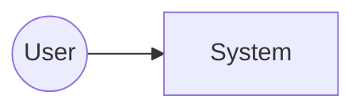

# Solution Architecture

## 1. Context (C4 L1)

## 2. Containers (C4 L2)
## 3. Key flows (sequence diagrams per critical FR)
## 4. Data model & classification
| Entity | Classification | Store | Retention |
|---|---|---|---|
## 5. Trust boundaries
| ID | Boundary | Crossing data | AuthN/AuthZ |
|---|---|---|---|
| TB-01 | | | |
## 6. Deployment topology & environments
## 7. Observability (logs, traces, metrics, alerts, SLOs)
## 8. Resilience (backup, DR, RTO/RPO)
## 9. Cost estimate
| Component | SKU | Monthly est. | Assumptions |
|---|---|---|---|
## 10. Decisions (links to ADRs)
## 11. Risks & open questions
